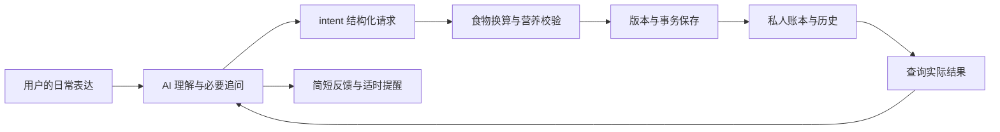

# 项目结构与职责

health-log 是配合工具型 AI 使用的本地饮食、体重记录引擎。界面由 AI 宿主提供，
AI 理解用户表达；引擎负责计算、校验和保存。没有内置聊天服务器、模型 API 或后台通知服务。

## 两个使用项目

| 项目 | 内容 | 保存与更新 |
| --- | --- | --- |
| 程序项目 `health-log` | 可复用源码、运行模板、安装入口和使用文档 | 可重新下载；不存个人饮食、体重、密钥 |
| 个人账本，例如 `health-data` | 个人记录、设置、规则、食品标签、操作历史与 `.hl` | 放私人持久目录；完整备份；可选私有 Git 仓库 |

程序升级不会自动迁移个人账本，也不会自动覆盖个人 AI 规则。
公开程序与私有账本的分发规则见[项目与发布边界](publication.md)。私有开发材料另行保留，不写进个人账本。

## 一次记录如何完成



AI 可以按常见份量估算已经说出的“一碗”，不能凭空给没有份量的食物补一碗。
引擎检查数值、单位和估算的一致性，不能证明 AI 的语义解释与真实进食完全一致。
用户可随时更正，历史保留前后状态。

## 源码布局

```text
health-log/
  README.md                  普通人入口与文档导航
  AGENTS.md                  源码开发约定
  CONTRIBUTING.md            开发与协作入口
  pyproject.toml / uv.lock    依赖与打包配置
  scripts/
    bootstrap.py             建立本项目运行环境
    runtime.py               解释器、依赖与启动检查
    hl.py                    调用当前源码的统一入口
  src/hl/
    cli.py / cli_parser.py   命令解析与分发
    intents/                 唯一日常写协议、操作收据、更正与查询
    foods/                   食物来源、搜索、换算与营养数据
    storage/                 文件读写、锁、事务恢复、可选 Git
    ledgercheck/             账本完整性检查与恢复诊断
    manifests/               受保护文件清单与变更核对
    commands/                查询、安装、校验等命令适配
    data/                    随包提供的规则、模式与 Agent 模板
  docs/                      使用、安装、迁移与接入说明
```

表中是主要职责，不是全部 Python 模块清单。已有兼容读取和来源处理模块继续保留，
不为缩短目录而把不同职责合并。`data/` 是运行资源，不能和开发过程材料一起排除。

| 所有者 | 负责什么 | 不负责什么 |
| --- | --- | --- |
| `intents.contract` | 请求结构与字段校验 | 用原话关键词裁决语义 |
| `intents.service` | 唯一日常写编排、稳定请求 ID | 另建第二套自然语言写入口 |
| `intents.nutrition`、`foods` | 结构化份量到营养行、真实/估算来源 | 猜用户没说的进食数量 |
| `intents.state` | 操作收据、确认快照和变更审计 | 替代真实账本数据 |
| `storage.transactions` | 同锁、多文件提交与崩溃回滚 | 无条件覆盖并发修改 |
| `ledgercheck`、`manifests` | 签名、清单、格式与一致性 | 将坏记录重新签名以消除报错 |
| `scripts/runtime.py` | 本地环境检查与解释器选择 | 复制营养或写账业务规则 |

## 数据可靠性

- 同一个用户事件重试使用同一个请求 ID，重复请求不会重复落账。
- 更正绑定查询到的当前版本；其他会话已修改时拒绝旧版本覆盖。
- 只更正点名的项目，其他项目保持原样；跨日期移动和收据更新放在同一事务中。
- 中断后先验证并恢复事务，再继续查询或写入；损坏签名不能自动重签。
- 数据格式 1 可读，写入前要预检、完整备份并迁移到格式 2。

这些机制防止误操作与不一致，无法防止拥有整台电脑和密钥的人伪造记录。
备份、换机和恢复的实际操作见[迁移说明](migration.md)。

## 文档和工程取舍

首页聚焦用途、开始使用与帮助入口，长说明拆到对应文档；`src` 布局隔离可导入代码和仓库杂项。
这些取舍参考 [GitHub README 指南](https://docs.github.com/en/repositories/managing-your-repositorys-settings-and-features/customizing-your-repository/about-readmes)
和 [PyPA 的 src 布局说明](https://packaging.python.org/en/latest/discussions/src-layout-vs-flat-layout/)。
测试是否公开是项目自身的分发选择，并非 Python 或 GitHub 的统一要求。
