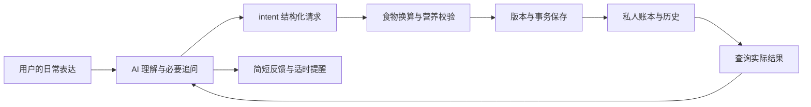

# 项目结构与职责

health-log 是配合工具型 AI 使用的本地饮食、体重记录引擎。界面由 AI 宿主提供，
AI 理解用户表达；引擎负责计算、校验和保存。没有内置聊天服务器、模型 API 或后台通知服务。

## 一个使用项目，两种分发状态

公共模板包含可复用的程序、规则、依赖声明和文档。用户从它建立自己的完整私有副本，
在同一目录初始化账本；AI 打开这个目录、读取根 `AGENTS.md` 后即可准备环境和继续记录。
程序与个人数据在职责上分开，在默认使用方式中属于同一个持久项目。

| 状态 | 内容 | 如何保存 |
| --- | --- | --- |
| 公共模板 | 通用源码、运行规则、安装入口、文档和可分发数据 | 不含个人账本、凭据或私有开发历史 |
| 用户的完整私有项目 | 上述程序加个人配置、记录、规则、食品库和 `.hl` | 私人持久目录；可选私有 Git；完整项目备份 |

源码入口 `python3 scripts/hl.py` 默认选择这个脚本所属的项目根目录，并忽略继承的 `HL_DATA`，
不随终端当前目录漂移。显式 `--data` 或 `init DIR` 仍兼容外部账本；裸安装的 `hl` 保留旧路径选择行为。
程序升级只替换允许的程序文件，不自动迁移数据或覆盖个人规则。
公开模板与使用后项目的边界见[项目与发布说明](publication.md)。

## 一次记录如何完成



AI 可以按常见份量估算已经说出的“一碗”，不能凭空给没有份量的食物补一碗。
引擎检查数值、单位和估算的一致性，不能证明 AI 的语义解释与真实进食完全一致。
用户可随时更正，历史保留前后状态。

## 源码布局

```text
health-log/
  README.md                  普通人入口与文档导航
  AGENTS.md                  日常 AI 入口；读规则、准备本项目、处理记录
  CONTRIBUTING.md            开发与协作入口
  pyproject.toml / uv.lock    依赖与打包配置
  scripts/
    bootstrap.py             建立本项目运行环境
    runtime.py               解释器、依赖与启动检查
    hl.py                    调用当前源码，默认账本为本项目根目录
  data/foods/                食品快照说明和校验清单；完整 raw/compiled 仅在私有工程保存
  src/hl/
    cli.py / cli_parser.py   命令解析与分发
    intents/                 唯一日常写协议、操作收据、更正与查询
    foods/                   食物来源、搜索、换算与营养数据
    storage/                 文件读写、锁、事务恢复、可选 Git
    ledgercheck/             账本完整性检查与恢复诊断
    manifests/               受保护文件清单与变更核对
    commands/                查询、安装、校验等命令适配
    data/                    随包提供的规则、模式与 Agent 模板
  docs/                      使用、安装、迁移与接入说明
  hl.toml                    初始化后生成的私人配置
  log/                       私人饮食和体重记录
  plan.yaml / defaults.yaml  可选的个人计划和默认
  foods/                     个人食品与标签
  .hl/                       密钥、清单、事务、操作历史和食品缓存
  .venv/                     可重新建立的本机运行环境
```

后六行是用户使用时生成的私有内容，不随公共模板分发；可选设置文件按使用情况产生。
表中是主要职责，不是全部 Python 模块清单。已有兼容读取和来源处理模块继续保留，
不为缩短目录而把不同职责合并。`data/` 是运行资源，不能和开发过程材料一起排除。

`src/hl/data` 中的自有概念、菜谱、量词和参考表随程序提供；根目录 `data/foods` 则记录完整营养快照。
私有工程保留原始数据与整理后结果，已有 `foods build` 负责从原始数据离线构建，
无需另建一套营养计算器。公开分发只带快照说明与校验清单，具体范围见[项目数据](../data/foods/README.md)。

| 所有者 | 负责什么 | 不负责什么 |
| --- | --- | --- |
| `intents.contract` | 请求结构与字段校验 | 用原话关键词裁决语义 |
| `intents.service` | 唯一日常写编排、稳定请求 ID | 另建第二套自然语言写入口 |
| `intents.nutrition`、`foods` | 结构化份量到营养行、真实/估算来源 | 猜用户没说的进食数量 |
| `intents.state` | 操作收据、确认快照和变更审计 | 替代真实账本数据 |
| `storage.transactions` | 同锁、多文件提交与崩溃回滚 | 无条件覆盖并发修改 |
| `ledgercheck`、`manifests` | 签名、清单、格式与一致性 | 将坏记录重新签名以消除报错 |
| `scripts/runtime.py` | 本地环境检查与解释器选择 | 复制营养或写账业务规则 |

## 数据可靠性

- 同一个用户事件重试使用同一个请求 ID，重复请求不会重复落账。
- 更正绑定查询到的当前版本；其他会话已修改时拒绝旧版本覆盖。
- 只更正点名的项目，其他项目保持原样；跨日期移动和收据更新放在同一事务中。
- 中断后先验证并恢复事务，再继续查询或写入；损坏签名不能自动重签。
- 数据格式 1 可读，写入前要预检、完整备份并迁移到格式 2。

这些机制防止误操作与不一致，无法防止拥有整台电脑和密钥的人伪造记录。
备份、换机和恢复的实际操作见[迁移说明](migration.md)。

## 文档和工程取舍

首页聚焦用途、开始使用与帮助入口，长说明拆到对应文档；`src` 布局隔离可导入代码和仓库杂项。
这些取舍参考 [GitHub README 指南](https://docs.github.com/en/repositories/managing-your-repositorys-settings-and-features/customizing-your-repository/about-readmes)
和 [PyPA 的 src 布局说明](https://packaging.python.org/en/latest/discussions/src-layout-vs-flat-layout/)。
测试是否公开是项目自身的分发选择，并非 Python 或 GitHub 的统一要求。
